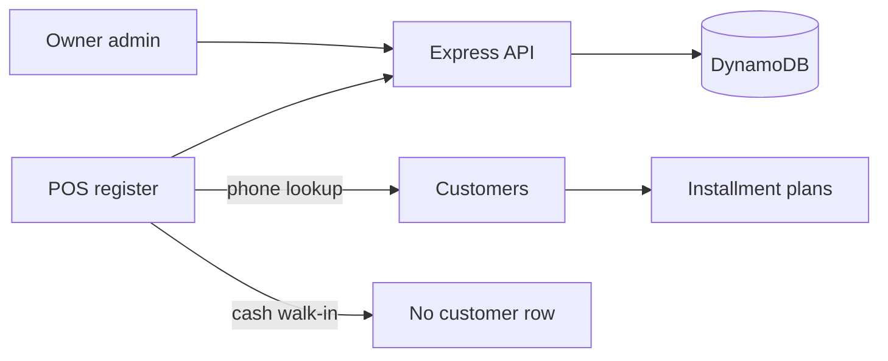

# POSBright API

**Multi-tenant retail backend for cash sales, installment credit, and inventory.**

[](https://expressjs.com/)
[](https://docs.aws.amazon.com/amazondynamodb/latest/developerguide/DynamoDBLocal.html)
[](https://jwt.io/)
[](https://github.com/thanuj88/smart-erp-frontend)

This API is the store engine behind POSBright. It keeps **teller-safe sales** separate from **owner-only profit**, matches members by **phone**, and tracks installment plans without mixing return stock into the floor.

Use it with [`smart-erp-frontend`](https://github.com/thanuj88/smart-erp-frontend).

---

## What it serves



- Cash and installment checkout
- Inventory, categories, promotions
- Customer CRM (phone is the unique member id)
- Installment plans, payments, overdue summaries
- Returns: cash, warranty, defect
- Tenant settings, roles, and platform admin
- JWT auth with capability codes (`sales:create`, `reports:view`, `users:manage`, …)

---

## Stack

- **Node.js** + **Express**
- **Amazon DynamoDB** (Local for development)
- **JWT** access + refresh tokens, PIN login for tellers
- Multi-tenant partition keys per store

```
backend
├── routes/             HTTP surface under /api
├── controllers/
├── services/
├── repositories/dynamodb/
├── middleware/         auth, permissions, validation
└── scripts/            table init, seed, catalog
```

Default API: `http://localhost:5000/api`

---

## Quick start

**Prerequisites:** Node.js 18+, Java 8+ (for DynamoDB Local).

```bash
git clone https://github.com/thanuj88/smart-erp-backend.git
cd smart-erp-backend
npm install
```

Copy environment values (see [DYNAMODB.md](DYNAMODB.md)):

```
PORT=5000
DYNAMODB_ENDPOINT=http://localhost:8000
DYNAMODB_TABLE=PosBright
AWS_REGION=us-east-1
AWS_ACCESS_KEY_ID=local
AWS_SECRET_ACCESS_KEY=local
```

Terminal 1, keep DynamoDB running:

```bash
npm run dynamo:up
```

Terminal 2:

```bash
npm run dev
```

Health check: [http://localhost:5000/api/health](http://localhost:5000/api/health)

On first boot the API creates the table and seeds **Bright Mart** if accounts are missing.

### Demo logins

| Role | Email | Password |
| --- | --- | --- |
| Super admin | `superadmin@platform.local` | `superadmin123` |
| Tenant admin | `admin@brightmart.local` | `admin123` |
| Teller | `teller@brightmart.local` | `teller123` (PIN `1234`) |
| Manager | `manager@brightmart.local` | `manager123` |
| Accountant | `accountant@brightmart.local` | `accountant123` |

---

## Useful scripts

| Command | Purpose |
| --- | --- |
| `npm run dynamo:up` | Start DynamoDB Local on disk |
| `npm run dev` | API with nodemon |
| `npm run seed-dynamo` | Ensure demo users and roles |
| `npm run seed-catalog` | Fill Bright Mart products and customers |

More detail: [DYNAMODB.md](DYNAMODB.md)

---

## Related

- Store UI: [thanuj88/smart-erp-frontend](https://github.com/thanuj88/smart-erp-frontend)
- Product: **POSBright** · store inventory and point of sale

<p align="center"><sub>One API for many shops. Profit stays with the owner.</sub></p>
