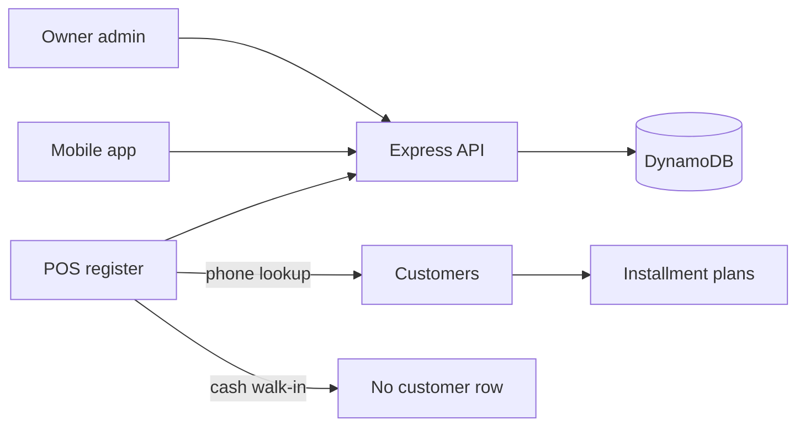

# POSBright API

**Multi-tenant retail backend for cash sales, installment credit, and inventory.**

[](https://expressjs.com/)
[](https://docs.aws.amazon.com/amazondynamodb/latest/developerguide/DynamoDBLocal.html)
[](https://jwt.io/)
[](https://github.com/thanuj88/smart-erp-frontend)

This API is the store engine behind POSBright. It keeps **teller-safe sales** separate from **owner-only profit**, matches members by **phone**, and tracks installment plans without mixing return stock into the floor.

Use it with [`smart-erp-frontend`](https://github.com/thanuj88/smart-erp-frontend) and the PosBright mobile app.

---

## What it serves



- Cash and installment checkout (server-priced totals, idempotent cash sales)
- Inventory, categories, promotions, barcode lookup
- Customer CRM (phone is the unique member id)
- Installment plans, payments, overdue summaries
- Returns: cash, warranty, defect
- Tenant settings, roles, and platform admin
- JWT auth with capability codes (`sales:create`, `reports:view`, `users:manage`, …)

Cost and profit are stripped from responses for users who cannot view reports.

---

## API surface

All routes live under `/api`. Health check: `GET /api/health`.

| Prefix | Covers |
| --- | --- |
| `/auth` | Email and PIN login, refresh, logout, profile, sessions, password reset |
| `/items` | Catalogue, search, barcode, stock writes |
| `/categories` | Category list and edits |
| `/promotions` | Automatic discounts |
| `/sales` | Cash and installment checkout, orders, returns, summaries |
| `/customers` | CRM and phone lookup used by the till |
| `/installment-plans` | Plans and status |
| `/installment-payments` | Pending, overdue, record a payment |
| `/installment-settings` | Term lengths for a store |
| `/users` | Staff accounts |
| `/settings` | Store branding, currency, receipt |
| `/witnesses` | Installment witness ID images |
| `/platform` | Tenants, plans, roles, platform users |

Product images are served from `/uploads`. Private ID images are blocked on that path.

---

## Stack

- **Node.js** + **Express**
- **Amazon DynamoDB** (Local for development), single table `PosBright`
- **JWT** access + refresh tokens, PIN login for tellers
- Multi-tenant partition keys per store

```
backend
├── routes/                  HTTP surface under /api
├── controllers/
├── services/
├── repositories/dynamodb/
├── middleware/              auth, permissions, validation, rate limits
├── scripts/                 table init, seed, catalog, DynamoDB Local
└── test/                    node:test
```

Default API: `http://localhost:5000/api`

---

## Quick start

**Prerequisites:** Node.js 18+, Java 8+ (for DynamoDB Local). Docker is optional.

```bash
git clone https://github.com/thanuj88/smart-erp-backend.git
cd smart-erp-backend
npm install
copy .env.example .env
```

On macOS or Linux, use `cp .env.example .env`.

Local values (full list is in `.env.example` and [DYNAMODB.md](DYNAMODB.md)):

```
PORT=5000
NODE_ENV=development
DYNAMODB_ENDPOINT=http://localhost:8000
DYNAMODB_TABLE=PosBright
AWS_REGION=us-east-1
AWS_ACCESS_KEY_ID=local
AWS_SECRET_ACCESS_KEY=local
APP_URL=http://localhost:3000
```

Terminal 1, keep DynamoDB running (data stays in `dynamodb-data/`):

```bash
npm run dynamo:up
```

Terminal 2:

```bash
npm run dev
```

Health check: [http://localhost:5000/api/health](http://localhost:5000/api/health)

On first boot the API creates the table and seeds **Bright Mart** when accounts are missing. Demo accounts are created only when `NODE_ENV` is `development` or `test`.

Outside development the process refuses to start on the placeholder JWT secrets. Generate real secrets with:

```bash
node -e "console.log(require('crypto').randomBytes(48).toString('hex'))"
```

Set both `JWT_SECRET` and a different `JWT_REFRESH_SECRET` (32+ characters each). Production sign-up and password reset also need SMTP (`SMTP_HOST` and related values in `.env.example`).

### Demo logins

| Role | Email | Password |
| --- | --- | --- |
| Super admin | `superadmin@platform.local` | `superadmin123` |
| Tenant admin | `admin@brightmart.local` | `admin123` |
| Teller | `teller@brightmart.local` | `teller123` (no PIN; set `DEMO_TELLER_PIN`, 6 to 8 digits) |
| Manager | `manager@brightmart.local` | `manager123` |
| Accountant | `accountant@brightmart.local` | `accountant123` |

Sign in with **email**.

---

## Scripts

| Command | Purpose |
| --- | --- |
| `npm run dynamo:up` | Start DynamoDB Local on disk (needs Java) |
| `npm run dynamo:up:docker` | Start DynamoDB Local with Docker Compose |
| `npm run dev` | API with nodemon |
| `npm start` | API without reload |
| `npm test` | `node --test` suite |
| `npm run seed-dynamo` | Ensure demo users and roles |
| `npm run seed-catalog` | Fill Bright Mart products and customers |
| `npm run init-dynamo` | Create the table |

More on persistence and Docker: [DYNAMODB.md](DYNAMODB.md)

---

## Related

- Store UI: [thanuj88/smart-erp-frontend](https://github.com/thanuj88/smart-erp-frontend)
- Product: **POSBright** · store inventory and point of sale

<p align="center"><sub>One API for many shops. Profit stays with the owner.</sub></p>
